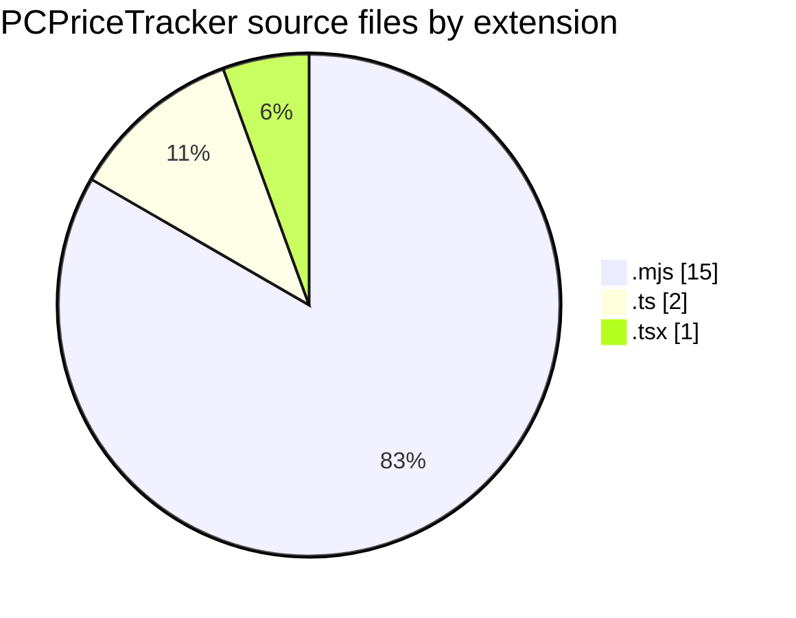

# Hi, I’m Ajit

I like building tools for questions I run into myself. When I’m comparing PC parts, I want to know whether today’s price is actually a good deal. When I’m trying an AI tool, I want to see which parts of its answer I can check.

## Featured work

| Project | What you can inspect |
| --- | --- |
| **[PCPriceTracker](https://github.com/Ajitprojects/PCPriceTracker)** | An Expo and React Native app for Indian PC component listings. Follow a price from the [collection script](https://github.com/Ajitprojects/PCPriceTracker/blob/main/collectTrackedProducts.mjs) through Supabase to the app’s price-history chart. |
| **[Evidence to Prompt](labs/evidence-to-prompt)** | A local prompt builder for fictional case notes. Try the example, use the prompt in an AI assistant, and check whether the answer invents a cause or customer impact. |
| **[Incident Operations Dashboard](https://github.com/Ajitprojects/incident-operations-dashboard)** | A browser demo with four fictional incidents. Switch the filter to **Open** to see why detection time is measurable while recovery time is still unknown. |

## Inside PCPriceTracker

The project combines a TypeScript mobile app with JavaScript scripts for collecting retailer prices. This chart counts source files in the [inspected revision](https://github.com/Ajitprojects/PCPriceTracker/tree/055b3cb1577c53d50442b27dc9626519296212c1).

## How I use AI

I use AI to help prototype tools and write documentation. One exercise I like is to ask for an incident summary and check it sentence by sentence. A timeout in a log is an observation. Calling it the root cause takes more evidence. The [worked example](labs/evidence-to-prompt#a-claim-you-can-check) shows what that distinction looks like in practice.
